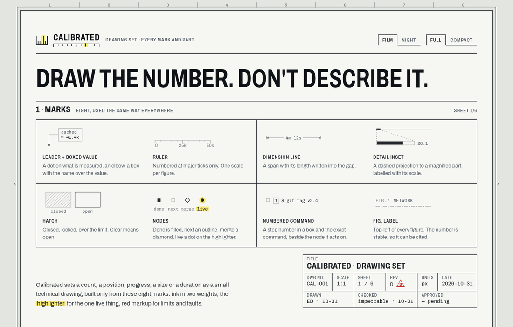
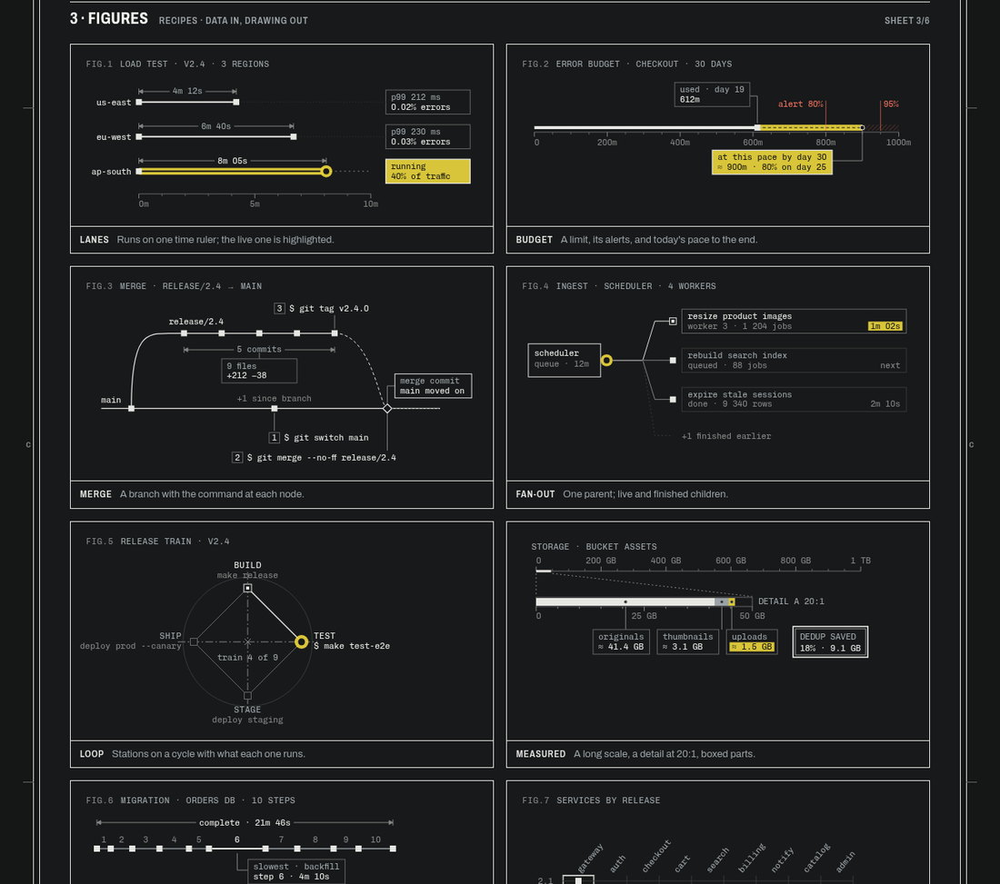

# Calibrated

**A technical-drawing design language for UIs, packaged as Claude Code skills.**

Calibrated draws a count, a position, progress, a size or a duration as a small technical figure instead of a sentence: rulers, leader lines to boxed values, dimension lines, detail insets, hatching and status nodes. Every page is a drawing sheet: graphite ink on drafting film, two line weights, a zone frame, a title block. A highlighter marks the one live thing. Everything is pure CSS and dependency-free vanilla JS. There's no build step and no framework, so it drops into any stack and into Claude artifacts.





## Skills

| skill | what it gives Claude |
|---|---|
| **calibrated-tokens** | `calibrated.css`: seed colours (`--bg` sheet, `--fg` ink, `--live` highlighter, plus `--ok` and `--fault`) with every other colour derived by `color-mix()`, a light "film" and a dark "night" theme, two line weights, type roles, base utilities. |
| **calibrated-figures** | `calibrated-figures.js`: the SVG kit (ruler, leader, boxed value, dimension line, detail inset, hatch, nodes, numbered command, FIG. label, centre line, highlight) plus `calibrated-recipes.js` with nine data-driven figures: lanes, budget, merge, fan-out, loop, measured, timeline, matrix and section. |
| **calibrated-components** | `calibrated-components.css/.js`: the drawing sheet with zone labels, title block, revision table and triangle, stamp, cards with before/after stages, ruled sections, boxed counts, counted tabs, ruled-cell buttons, tables, sign-off tally, and the custom elements `<cal-meter>`, `<cal-position>`, `<cal-progress>`, `<cal-diff>`, `<cal-durations>` and `<cal-ruler>`, each with full and compact forms. |
| **calibrated-artifacts** | Standalone. A single-file HTML template with the whole kit inlined, page patterns (review board, explainer, status report, spec sheet), copy-paste blocks and the artifact publishing rules. Use it to design Claude artifacts in the style. |

Each skill has a short `SKILL.md`, copy-ready files in `assets/` and the details in `references/`.

## Install

### As a Claude Code plugin
```
/plugin marketplace add <you>/calibrated
/plugin install calibrated@calibrated
```
Replace `<you>` with the GitHub account that hosts the repo. The skills then show up as `calibrated:calibrated-tokens`, `calibrated:calibrated-figures` and so on.

### By hand
Copy any folder from `skills/` into `~/.claude/skills/` (for all projects) or into `.claude/skills/` in one project.
```sh
git clone https://github.com/<you>/calibrated
cp -r calibrated/skills/* ~/.claude/skills/
```

## Use

Ask for it in plain words:
- "Build a deploy status page in the calibrated style."
- "Draw this error budget as a calibrated figure: 612 of 1000 minutes used, alerts at 80% and 95%."
- "Make a calibrated artifact reviewing these six UI changes, with keep/drop sign-off."
- "Re-theme calibrated with our brand colours: navy sheet, white ink, cyan highlighter."

Or use the files directly:
```html
<link rel="stylesheet" href="https://fonts.googleapis.com/css2?family=Archivo:wdth,wght@62..125,100..900&family=Chivo+Mono:wght@300..700&display=swap">
<link rel="stylesheet" href="calibrated.css">
<link rel="stylesheet" href="calibrated-components.css">
<script src="calibrated-figures.js" defer></script>
<script src="calibrated-components.js" defer></script>

<cal-meter value="46000" max="1000000" warn="800000" label="requests today"></cal-meter>
<cal-progress done="11" total="15" live="12" live-label="step 12 · backfill"></cal-progress>
<cal-diff added="184" removed="20"></cal-diff>
```

## The rules in one breath
A figure replaces text the UI already shows, using data it already has. It uses eight marks only and one scale per figure, with numbers at the major ticks. Values go in boxes on leaders. Everything is ink in two line weights; the highlighter marks the one live thing, red markup marks faults and limits, green marks what passed. Hatch means you can't. Full form prints the scale and boxes; compact keeps only the marks. Leave terminals, prompts and menus alone.

## Demo
Open `demo/index.html` in a browser: a catalog of the pages Claude can make in the style, each with a Plain / Calibrated switch and six colour finishes (`?theme=night` and `?view=plain` work too). The developer reference, with every mark, instrument, recipe and part and its code, is `demo/reference.html`.

## Fonts
The style uses **Archivo** (body, and condensed titles through its width axis) and **Chivo Mono** (legends, numbers, every SVG label). Both are OFL and on Google Fonts. The repo bundles no font files: the demo and the artifact template link Google Fonts, which Claude artifacts allow. Without them, the stacks fall back to Helvetica Neue/Arial and `ui-monospace`, and the figure kit measures labels with whatever font loaded. See `skills/calibrated-tokens/references/fonts.md`.

## Developing
- Edit the sources in `skills/calibrated-tokens`, `skills/calibrated-figures` and `skills/calibrated-components`.
- Run `node scripts/build-artifact-template.mjs` to regenerate the standalone copy in `skills/calibrated-artifacts` (template, inline kit and copied references). Commit its output.
- Check with `claude plugin validate .` and by opening the demo.
- The website is the demo, deployed to Vercel (`vercel.json`). `sh scripts/build-site.sh` copies `demo/*.html` and every `skills/*/assets` folder into `dist/`, so the site always serves the kit's current files. No dependencies or install step.

## License
MIT
